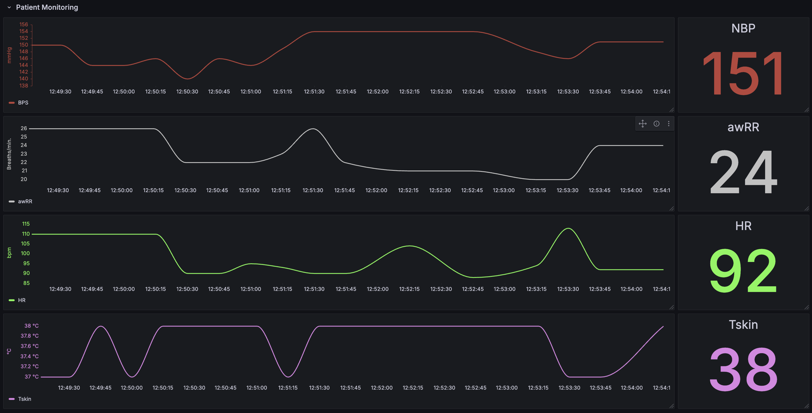
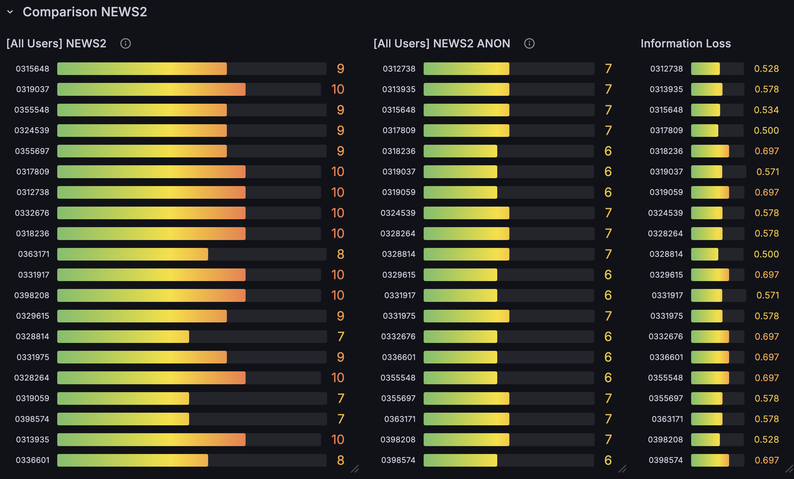
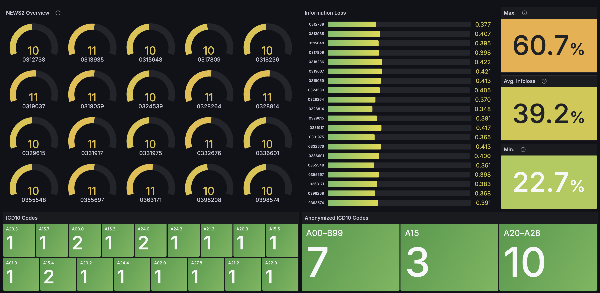
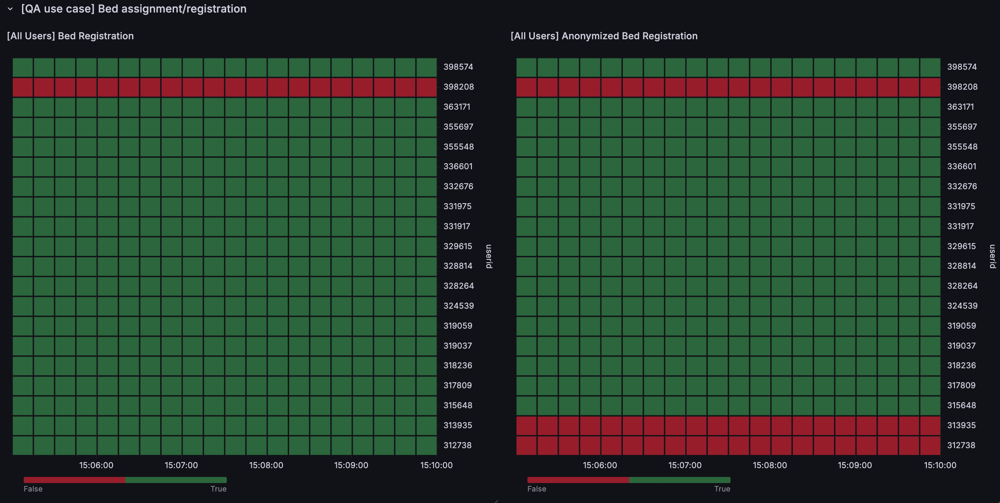
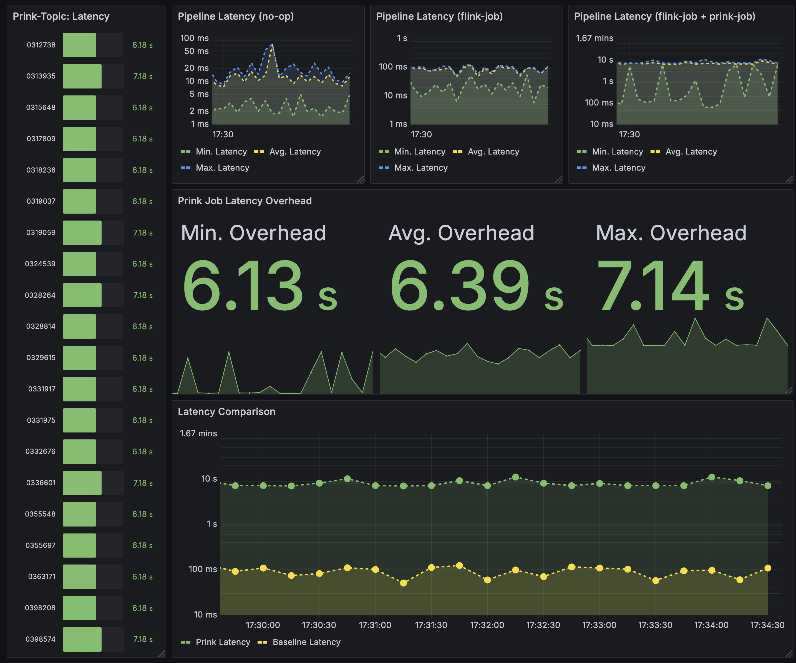

# Anonymization of Medical Data Streams using [Prink](https://github.com/PrivacyEngineering/prink)


---
## Overview
This repository contains a demo application for a Master's thesis project focused on the anonymization of medical data streams using [Prink](https://github.com/PrivacyEngineering/prink). The application consists of dockerized microservices to stream medical data and perform in-transit anonymization.

<details>
<summary><strong>Architecture Diagram</strong></summary>


</details>

### Key Features
- **Dockerized microservices**
- **Streaming medical data**
- **In-transit anonymization using [Prink](https://github.com/PrivacyEngineering/prink)**

---


## Getting Started

### Prerequisites

- [Docker](https://www.docker.com/)
- [Docker Compose](https://docs.docker.com/compose/)

### Build & Run
Runs on a single machine (Linux/macOS, amd64 or arm64) with synthetic data from `load-generator/output_json_files`.
```bash
make up            # = docker compose -p streamanon up --build -d
make smoke-test    # end-to-end check, exits non-zero on failure (scripts/smoke-test.sh)
make logs S="flink-taskmanager og-prink-job"   # follow logs of selected services
```
Plain `docker compose up --build -d` works as well (run `scripts/smoke-test.sh` afterwards).
The first build downloads Maven/pip dependencies and takes several minutes.
Both Flink jobs are submitted automatically once the JobManager is ready (`scripts/flink-submit.sh`)
and re-submitted if the cluster restarts; Grafana dashboards and the Prometheus datasource are
provisioned from `grafana/provisioning`.

#### Resource settings
The defaults fit Docker Desktop with ~8 GB memory (JobManager 1 GB, TaskManager 2 GB, Kafka 512 MB heap;
~6 GB in total). On a server, copy `.env.example` to `.env` and raise `FLINK_TM_PROCESS_SIZE`,
`FLINK_TM_MEM_LIMIT` etc.; the container memory limit must be larger than the Flink process size.

| Service         | URL                                                               | Default Credentials      |
|-----------------|-------------------------------------------------------------------|-------------------------|
| Prink Overview  | [http://localhost:8081/#/overview](http://localhost:8081/#/overview) | -                       |
| Grafana         | [http://localhost:3000/login](http://localhost:3000/login)           | `admin` / `admin`       |
| Prometheus      | [http://localhost:9090/query](http://localhost:9090/query)           | -                       |
> **Note:** To log in to Grafana, use credentials `admin/admin`, then choose `skip`.

### ...When finished
```bash
make down          # = docker compose -p streamanon down  (make clean also removes the volumes)
```
<details>
<summary><strong>Dashboard Views</strong></summary>









</details>

### Configuration

#### Privacy Parameters

| Parameter | Default Value |
|-----------|---------------|
| `k`       | 5             |
| `l`       | 3             |
| `delta`   | 125           |
| `beta`    | 50000         |
| `zeta`    | 10000         |
| `mu`      | 100           |

> **Note:** The privacy parameters can be configured in the [GangesEvaluation.java Prink Job](og-prink/src/main/java/ganges/GangesEvaluation.java) file.

#### Prink Kafka consumer properties
- `bootstrap.servers`: Kafka broker addresses.
- `group.id`: Consumer group ID.
- `key.deserializer`: Deserializer for the message key.
- `value.deserializer`: Deserializer for the message value.

> **Note:** The consumer properties (connecting Prink to other topics) can be configured in the [GangesEvaluation.java Prink Job](og-prink/src/main/java/ganges/GangesEvaluation.java) file.

#### Flink Configuration
- The Flink configuration file is located at `flink-conf.yaml` (mounted read-only and used as `conf/config.yaml` by the Flink 1.19 containers; memory sizes are set via environment variables, see `.env.example`).
- Key configurations include:
  - `jobmanager.rpc.address`: Address of the job manager.
  - `taskmanager.numberOfTaskSlots`: Number of task slots per task manager.

#### Real monitor data (local only)
Real data must never be committed. Place exports in `load-generator/input/`
(ignored by git and by the Docker build) and convert them into per-patient
JSON files in `load-generator/output_dwc/` (also ignored):

```bash
cd load-generator
python3 convert_dwc.py --input input/<export>.csv.zip --output-dir output_dwc \
    --bucket-seconds 1 --ffill-seconds 0
```

`convert_dwc.py` maps Philips DWC numerics (`c_label`/`c_sub_label`) to
`resp`, `bps` (systolic only), `pulse`, `spo2` and `temp`, merges them into one
record per patient and time bucket, and prints aggregate statistics only. See
the module docstring for the mapping, filters and forward-fill options.

#### Load generator
`load-generator/producer.py` is configured via environment variables (also
settable in `docker-compose.yml` / `.env`):

| Variable          | Default             | Meaning                                                        |
|-------------------|---------------------|----------------------------------------------------------------|
| `INPUT_DIR`       | `output_json_files` | folder with one JSON file per patient                          |
| `RATE_HZ`         | `1`                 | `fixed-rate`: records per patient per second                   |
| `KAFKA_BOOTSTRAP` | `kafka:29092`       | Kafka bootstrap servers                                        |
| `REPLAY_MODE`     | `fixed-rate`        | `fixed-rate` or `original-timing` (uses `measured_at`)         |
| `SPEEDUP`         | `1`                 | `original-timing`: time acceleration factor                    |
| `LOOP`            | `1`                 | `0`: stop after the last record instead of starting over       |
| `LOG_MESSAGES`    | `0`                 | `1`: log every sent record                                     |

In `fixed-rate` mode every patient cycles through its own file independently,
so patient files may have different lengths.

## Third-Party Licenses
This project uses third-party components:
- Apache Kafka, Zookeeper, Flink, Prometheus (Apache 2.0)
- Grafana (AGPL v3)

These components are used as-is via container images. 

## License

This repository’s own source code is licensed under the [MIT License](LICENSE).

